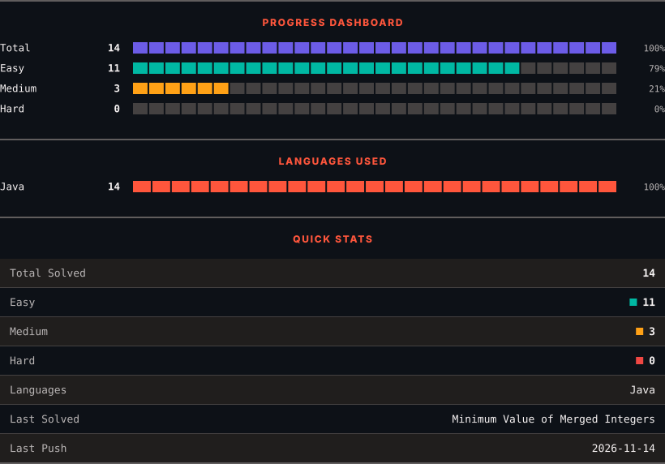
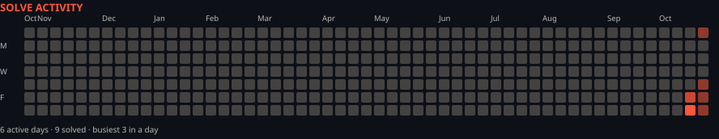

<h1>LeetCode Solutions</h1>

<em>Automatically synced with every accepted submission</em>

   

<picture>
  <source media="(prefers-color-scheme: dark)" srcset=".leetsync/stats-dark.svg">
  <source media="(prefers-color-scheme: light)" srcset=".leetsync/stats-light.svg">
  
</picture>

<picture>
  <source media="(prefers-color-scheme: dark)" srcset=".leetsync/calendar-dark.svg">
  <source media="(prefers-color-scheme: light)" srcset=".leetsync/calendar-light.svg">
  
</picture>

---

### ALL SOLUTIONS

| # | Problem | Difficulty | Language | Date |
|:---:|:--------|:----------:|:--------:|:----:|
| 1 | [Two Sum](problems/0001-Two-Sum) | 🟩 Easy | `Java` | 2026-10-31 |
| 3 | [Longest Substring Without Repeating Characters](problems/0003-Longest-Substring-Without-Repeating-Characters) | 🟧 Medium | `Java` | 2026-10-23 |
| 45 | [Jump Game II](problems/0045-Jump-Game-II) | 🟧 Medium | `Java` | 2026-11-11 |
| 202 | [Happy Number](problems/0202-Happy-Number) | 🟩 Easy | `Java` | 2026-10-24 |
| 290 | [Word Pattern](problems/0290-Word-Pattern) | 🟩 Easy | `Java` | 2026-10-24 |
| 350 | [Intersection of Two Arrays II](problems/0350-Intersection-of-Two-Arrays-II) | 🟩 Easy | `Java` | 2026-11-14 |
| 965 | [Univalued Binary Tree](problems/0965-Univalued-Binary-Tree) | 🟩 Easy | `Java` | 2026-11-04 |
| 1207 | [Unique Number of Occurrences](problems/1207-Unique-Number-of-Occurrences) | 🟩 Easy | `Java` | 2026-10-24 |
| 1512 | [Number of Good Pairs](problems/1512-Number-of-Good-Pairs) | 🟩 Easy | `Java` | 2026-10-30 |
| 1614 | [Maximum Nesting Depth of the Parentheses](problems/1614-Maximum-Nesting-Depth-of-the-Parentheses) | 🟩 Easy | `Java` | 2026-10-25 |
| 1748 | [Sum of Unique Elements](problems/1748-Sum-of-Unique-Elements) | 🟩 Easy | `Java` | 2026-11-10 |
| 2352 | [Equal Row and Column Pairs](problems/2352-Equal-Row-and-Column-Pairs) | 🟧 Medium | `Java` | 2026-10-29 |
| 3142 | [Check if Grid Satisfies Conditions](problems/3142-Check-if-Grid-Satisfies-Conditions) | 🟩 Easy | `Java` | 2026-10-23 |
| 4097 | [Minimum Value of Merged Integers](problems/4097-Minimum-Value-of-Merged-Integers) | 🟩 Easy | `Java` | 2026-11-02 |

---

Auto-synced by <strong>LeetSync</strong> · Built by <a href="https://deveshsamant.in/">Devesh Samant</a>

