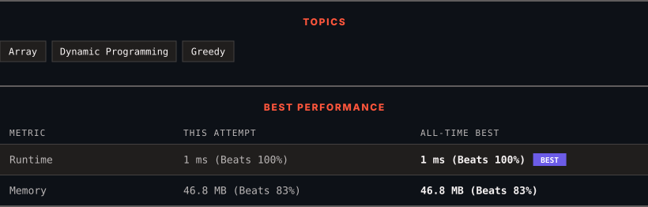

<div align="center">

# 45. Jump Game II

      

[](https://leetcode.com/problems/jump-game-ii/)

</div>

---

<div align="center">

<picture>
  <source media="(prefers-color-scheme: dark)" srcset="panel-dark.svg">
  <source media="(prefers-color-scheme: light)" srcset="panel-light.svg">
  
</picture>

</div>

> **New personal best** — Runtime improved on this submission.

### HOW IT WENT

| | |
|:--|:--|
| **Attempts** | first try |
| **Time to solve** | 1 min |
| **Verdicts** | ✅ Accepted |

---

### NOTES

_No notes yet._

---

### SOLUTIONS (1)

| # | File | Language | Date |
|:-:|------|:--------:|:----:|
| 1 | [sol1.java](./sol1.java) | `Java` | 2026-11-11 ← **latest** |

---

### PROBLEM DESCRIPTION

You are given a **0-indexed** array of integers `nums` of length `n`. You are initially positioned at index 0.

Each element `nums[i]` represents the maximum length of a forward jump from index `i`. In other words, if you are at index `i`, you can jump to any index `(i + j)` where:

	- `0 <= j <= nums[i]` and

	- `i + j < n`

Return *the minimum number of jumps to reach index *`n - 1`. The test cases are generated such that you can reach index `n - 1`.

 

**Example 1:**

```

**Input:** nums = [2,3,1,1,4]
**Output:** 2
**Explanation:** The minimum number of jumps to reach the last index is 2. Jump 1 step from index 0 to 1, then 3 steps to the last index.

```

**Example 2:**

```

**Input:** nums = [2,3,0,1,4]
**Output:** 2

```

 

**Constraints:**

	- `1 <= nums.length <= 10^4`

	- `0 <= nums[i] <= 1000`

	- It's guaranteed that you can reach `nums[n - 1]`.

---

<div align="center">

<sub>Auto-synced by <strong>LeetSync</strong> · Built by <a href="https://deveshsamant.in/">Devesh Samant</a></sub>

</div>
