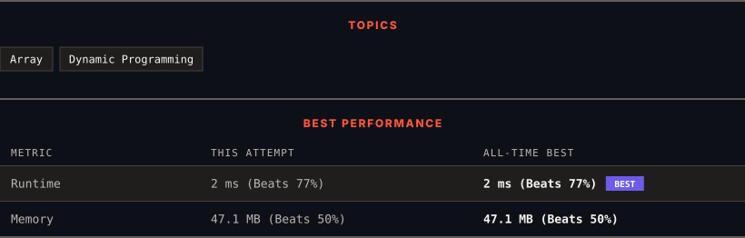

<div align="center">

# 152. Maximum Product Subarray

      

[](https://leetcode.com/problems/maximum-product-subarray/)

</div>

---

<div align="center">

<picture>
  <source media="(prefers-color-scheme: dark)" srcset="panel-dark.svg">
  <source media="(prefers-color-scheme: light)" srcset="panel-light.svg">
  
</picture>

</div>

> **New personal best** — Runtime improved on this submission.

### HOW IT WENT

| | |
|:--|:--|
| **Attempts** | 4 before accepted |
| **Time to solve** | 22 min |
| **Verdicts** | ❌ Wrong Answer → ❌ Wrong Answer → ❌ Wrong Answer → ✅ Accepted |

---

### NOTES

_No notes yet._

---

### SOLUTIONS (1)

| # | File | Language | Date |
|:-:|------|:--------:|:----:|
| 1 | [sol1.java](./sol1.java) | `Java` | 2026-11-20 ← **latest** |

---

### PROBLEM DESCRIPTION

Given an integer array `nums`, find a subarray that has the largest product, and return *the product*.

The test cases are generated so that the answer will fit in a **32-bit** integer.

**Note** that the product of an array with a single element is the value of that element.

 

**​​​​​​​Example 1:**

```

**Input:** nums = [2,3,-2,4]
**Output:** 6
**Explanation:** [2,3] has the largest product 6.

```

**Example 2:**

```

**Input:** nums = [-2,0,-1]
**Output:** 0
**Explanation:** The result cannot be 2, because [-2,-1] is not a subarray.

```

 

**Constraints:**

	- `1 <= nums.length <= 2 * 10^4`

	- `-10 <= nums[i] <= 10`

	- The product of any subarray of `nums` is **guaranteed** to fit in a **32-bit** integer.

---

<div align="center">

<sub>Auto-synced by <strong>LeetSync</strong> · Built by <a href="https://deveshsamant.in/">Devesh Samant</a></sub>

</div>
