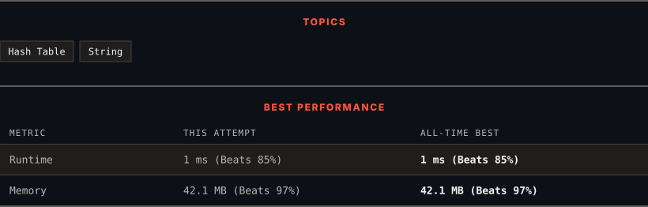

# 290. Word Pattern

      

---

<picture>
  <source media="(prefers-color-scheme: dark)" srcset="panel-dark.svg">
  <source media="(prefers-color-scheme: light)" srcset="panel-light.svg">
  
</picture>

### HOW IT WENT

| | |
|:--|:--|
| **Attempts** | 2 before accepted |
| **Time to solve** | 8 h 15 min |
| **Verdicts** | ✅ Accepted → ✅ Accepted |

---

### NOTES

_No notes yet._

---

### SOLUTIONS (2)

| # | File | Language | Date |
|:-:|------|:--------:|:----:|
| 1 | [sol1.java](./sol1.java) | `Java` | 2026-10-24 |
| 2 | [sol2.java](./sol2.java) | `Java` | 2026-10-24 ← **latest** |

---

### PROBLEM DESCRIPTION

Given a `pattern` and a string `s`, find if `s` follows the same pattern.

Here **follow** means a full match, such that there is a bijection between a letter in `pattern` and a **non-empty** word in `s`. Specifically:

	- Each letter in `pattern` maps to **exactly** one unique word in `s`.

	- Each unique word in `s` maps to **exactly** one letter in `pattern`.

	- No two letters map to the same word, and no two words map to the same letter.

 

**Example 1:**

**Input:** pattern = "abba", s = "dog cat cat dog"

**Output:** true

**Explanation:**

The bijection can be established as:

	- `'a'` maps to `"dog"`.

	- `'b'` maps to `"cat"`.

**Example 2:**

**Input:** pattern = "abba", s = "dog cat cat fish"

**Output:** false

**Example 3:**

**Input:** pattern = "aaaa", s = "dog cat cat dog"

**Output:** false

 

**Constraints:**

	- `1 <= pattern.length <= 300`

	- `pattern` contains only lower-case English letters.

	- `1 <= s.length <= 3000`

	- `s` contains only lowercase English letters and spaces `' '`.

	- `s` **does not contain** any leading or trailing spaces.

	- All the words in `s` are separated by a **single space**.

---

Auto-synced by <strong>LeetSync</strong> · Built by <a href="https://deveshsamant.in/">Devesh Samant</a>

