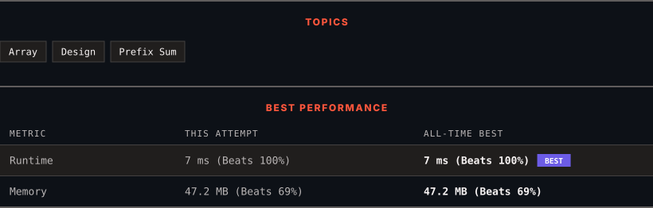

<div align="center">

# 303. Range Sum Query - Immutable

      

[](https://leetcode.com/problems/range-sum-query-immutable/)

</div>

---

<div align="center">

<picture>
  <source media="(prefers-color-scheme: dark)" srcset="panel-dark.svg">
  <source media="(prefers-color-scheme: light)" srcset="panel-light.svg">
  
</picture>

</div>

> **New personal best** — Runtime improved on this submission.

### HOW IT WENT

| | |
|:--|:--|
| **Attempts** | 2 before accepted |
| **Time to solve** | under a minute |
| **Verdicts** | 🔧 Compile Error → ✅ Accepted |

---

### NOTES

_No notes yet._

---

### SOLUTIONS (1)

| # | File | Language | Date |
|:-:|------|:--------:|:----:|
| 1 | [sol1.java](./sol1.java) | `Java` | 2026-11-25 ← **latest** |

---

### PROBLEM DESCRIPTION

Given an integer array `nums`, handle multiple queries of the following type:

	- Calculate the **sum** of the elements of `nums` between indices `left` and `right` **inclusive** where `left <= right`.

Implement the `NumArray` class:

	- `NumArray(int[] nums)` Initializes the object with the integer array `nums`.

	- `int sumRange(int left, int right)` Returns the **sum** of the elements of `nums` between indices `left` and `right` **inclusive** (i.e. `nums[left] + nums[left + 1] + ... + nums[right]`).

 

**Example 1:**

```

**Input**
["NumArray", "sumRange", "sumRange", "sumRange"]
[[[-2, 0, 3, -5, 2, -1]], [0, 2], [2, 5], [0, 5]]
**Output**
[null, 1, -1, -3]

**Explanation**
NumArray numArray = new NumArray([-2, 0, 3, -5, 2, -1]);
numArray.sumRange(0, 2); // return (-2) + 0 + 3 = 1
numArray.sumRange(2, 5); // return 3 + (-5) + 2 + (-1) = -1
numArray.sumRange(0, 5); // return (-2) + 0 + 3 + (-5) + 2 + (-1) = -3

```

 

**Constraints:**

	- `1 <= nums.length <= 10^4`

	- `-10^5 <= nums[i] <= 10^5`

	- `0 <= left <= right < nums.length`

	- At most `10^4` calls will be made to `sumRange`.

---

<div align="center">

<sub>Auto-synced by <strong>LeetSync</strong> · Built by <a href="https://deveshsamant.in/">Devesh Samant</a></sub>

</div>
