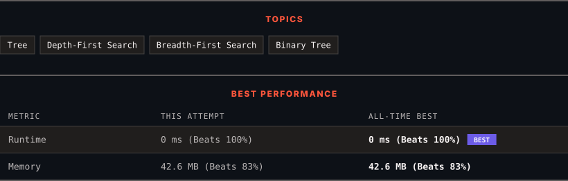

<div align="center">

# 965. Univalued Binary Tree

      

[](https://leetcode.com/problems/univalued-binary-tree/)

</div>

---

<div align="center">

<picture>
  <source media="(prefers-color-scheme: dark)" srcset="panel-dark.svg">
  <source media="(prefers-color-scheme: light)" srcset="panel-light.svg">
  
</picture>

</div>

> **New personal best** — Runtime improved on this submission.

### HOW IT WENT

| | |
|:--|:--|
| **Attempts** | first try |
| **Time to solve** | 1 min |
| **Verdicts** | ✅ Accepted |

---

### NOTES

_No notes yet._

---

### SOLUTIONS (1)

| # | File | Language | Date |
|:-:|------|:--------:|:----:|
| 1 | [sol1.java](./sol1.java) | `Java` | 2026-11-04 ← **latest** |

---

### PROBLEM DESCRIPTION

A binary tree is **uni-valued** if every node in the tree has the same value.

Given the `root` of a binary tree, return `true`* if the given tree is **uni-valued**, or *`false`* otherwise.*

 

**Example 1:**


```

**Input:** root = [1,1,1,1,1,null,1]
**Output:** true

```

**Example 2:**


```

**Input:** root = [2,2,2,5,2]
**Output:** false

```

 

**Constraints:**

	- The number of nodes in the tree is in the range `[1, 100]`.

	- `0 <= Node.val < 100`

---

<div align="center">

<sub>Auto-synced by <strong>LeetSync</strong> · Built by <a href="https://deveshsamant.in/">Devesh Samant</a></sub>

</div>
