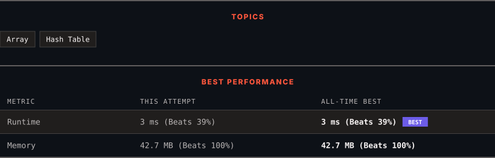

<div align="center">

# 1207. Unique Number of Occurrences

      

[](https://leetcode.com/problems/unique-number-of-occurrences/)

</div>

---

<div align="center">

<picture>
  <source media="(prefers-color-scheme: dark)" srcset="panel-dark.svg">
  <source media="(prefers-color-scheme: light)" srcset="panel-light.svg">
  
</picture>

</div>

> **New personal best** — Runtime improved on this submission.

### HOW IT WENT

| | |
|:--|:--|
| **Attempts** | first try |
| **Time to solve** | 8 min |
| **Verdicts** | ✅ Accepted |

---

### NOTES

_No notes yet._

---

### SOLUTIONS (1)

| # | File | Language | Date |
|:-:|------|:--------:|:----:|
| 1 | [sol1.java](./sol1.java) | `Java` | 2026-10-24 ← **latest** |

---

### PROBLEM DESCRIPTION

Given an array of integers `arr`, return `true` *if the number of occurrences of each value in the array is **unique** or *`false`* otherwise*.

 

**Example 1:**

```

**Input:** arr = [1,2,2,1,1,3]
**Output:** true
**Explanation:** The value 1 has 3 occurrences, 2 has 2 and 3 has 1. No two values have the same number of occurrences.
```

**Example 2:**

```

**Input:** arr = [1,2]
**Output:** false

```

**Example 3:**

```

**Input:** arr = [-3,0,1,-3,1,1,1,-3,10,0]
**Output:** true

```

 

**Constraints:**

	- `1 <= arr.length <= 1000`

	- `-1000 <= arr[i] <= 1000`

---

<div align="center">

<sub>Auto-synced by <strong>LeetSync</strong> · Built by <a href="https://deveshsamant.in/">Devesh Samant</a></sub>

</div>
