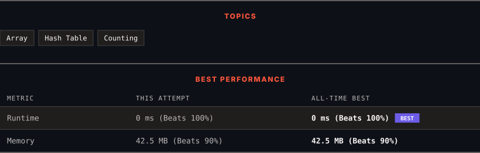

<div align="center">

# 1748. Sum of Unique Elements

      

[](https://leetcode.com/problems/sum-of-unique-elements/)

</div>

---

<div align="center">

<picture>
  <source media="(prefers-color-scheme: dark)" srcset="panel-dark.svg">
  <source media="(prefers-color-scheme: light)" srcset="panel-light.svg">
  
</picture>

</div>

> **New personal best** — Runtime improved on this submission.

### HOW IT WENT

| | |
|:--|:--|
| **Attempts** | first try |
| **Time to solve** | 5 min |
| **Verdicts** | ✅ Accepted |

---

### NOTES

_No notes yet._

---

### SOLUTIONS (1)

| # | File | Language | Date |
|:-:|------|:--------:|:----:|
| 1 | [sol1.java](./sol1.java) | `Java` | 2026-11-10 ← **latest** |

---

### PROBLEM DESCRIPTION

You are given an integer array `nums`. The unique elements of an array are the elements that appear **exactly once** in the array.

Return *the **sum** of all the unique elements of *`nums`.

 

**Example 1:**

```

**Input:** nums = [1,2,3,2]
**Output:** 4
**Explanation:** The unique elements are [1,3], and the sum is 4.

```

**Example 2:**

```

**Input:** nums = [1,1,1,1,1]
**Output:** 0
**Explanation:** There are no unique elements, and the sum is 0.

```

**Example 3:**

```

**Input:** nums = [1,2,3,4,5]
**Output:** 15
**Explanation:** The unique elements are [1,2,3,4,5], and the sum is 15.

```

 

**Constraints:**

	- `1 <= nums.length <= 100`

	- `1 <= nums[i] <= 100`

---

<div align="center">

<sub>Auto-synced by <strong>LeetSync</strong> · Built by <a href="https://deveshsamant.in/">Devesh Samant</a></sub>

</div>
