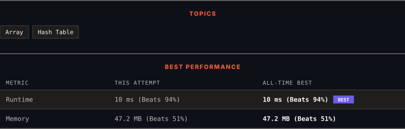

<div align="center">

# 2215. Find the Difference of Two Arrays

      

[](https://leetcode.com/problems/find-the-difference-of-two-arrays/)

</div>

---

<div align="center">

<picture>
  <source media="(prefers-color-scheme: dark)" srcset="panel-dark.svg">
  <source media="(prefers-color-scheme: light)" srcset="panel-light.svg">
  
</picture>

</div>

> **New personal best** — Runtime improved on this submission.

### HOW IT WENT

| | |
|:--|:--|
| **Attempts** | first try |
| **Time to solve** | 109 h 58 min |
| **Verdicts** | ✅ Accepted |

---

### NOTES

_No notes yet._

---

### SOLUTIONS (1)

| # | File | Language | Date |
|:-:|------|:--------:|:----:|
| 1 | [sol1.java](./sol1.java) | `Java` | 2026-11-18 ← **latest** |

---

### PROBLEM DESCRIPTION

Given two **0-indexed** integer arrays `nums1` and `nums2`, return *a list* `answer` *of size* `2` *where:*

	- `answer[0]` *is a list of all **distinct** integers in* `nums1` *which are **not** present in* `nums2`*.*

	- `answer[1]` *is a list of all **distinct** integers in* `nums2` *which are **not** present in* `nums1`.

**Note** that the integers in the lists may be returned in **any** order.

 

**Example 1:**

```

**Input:** nums1 = [1,2,3], nums2 = [2,4,6]
**Output:** [[1,3],[4,6]]
**Explanation:
**For nums1, nums1[1] = 2 is present at index 0 of nums2, whereas nums1[0] = 1 and nums1[2] = 3 are not present in nums2. Therefore, answer[0] = [1,3].
For nums2, nums2[0] = 2 is present at index 1 of nums1, whereas nums2[1] = 4 and nums2[2] = 6 are not present in nums1. Therefore, answer[1] = [4,6].
```

**Example 2:**

```

**Input:** nums1 = [1,2,3,3], nums2 = [1,1,2,2]
**Output:** [[3],[]]
**Explanation:
**For nums1, nums1[2] and nums1[3] are not present in nums2. Since nums1[2] == nums1[3], their value is only included once and answer[0] = [3].
Every integer in nums2 is present in nums1. Therefore, answer[1] = [].

```

 

**Constraints:**

	- `1 <= nums1.length, nums2.length <= 1000`

	- `-1000 <= nums1[i], nums2[i] <= 1000`

---

<div align="center">

<sub>Auto-synced by <strong>LeetSync</strong> · Built by <a href="https://deveshsamant.in/">Devesh Samant</a></sub>

</div>
