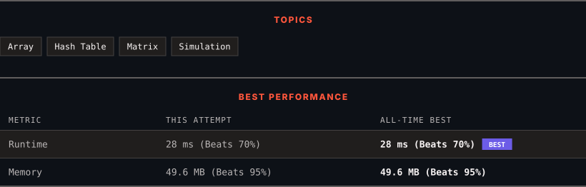

<div align="center">

# 2352. Equal Row and Column Pairs

      

[](https://leetcode.com/problems/equal-row-and-column-pairs/)

</div>

---

<div align="center">

<picture>
  <source media="(prefers-color-scheme: dark)" srcset="panel-dark.svg">
  <source media="(prefers-color-scheme: light)" srcset="panel-light.svg">
  
</picture>

</div>

### HOW IT WENT

| | |
|:--|:--|
| **Attempts** | 3 before accepted |
| **Time to solve** | 6 min |
| **Verdicts** | ✅ Accepted → 💥 Runtime Error → ✅ Accepted |

---

### NOTES

_No notes yet._

---

### SOLUTIONS (2)

| # | File | Language | Date |
|:-:|------|:--------:|:----:|
| 1 | [sol1.java](./sol1.java) | `Java` | 2026-10-29 |
| 2 | [sol2.java](./sol2.java) | `Java` | 2026-10-29 ← **latest** |

---

### PROBLEM DESCRIPTION

Given a **0-indexed** `n x n` integer matrix `grid`, *return the number of pairs *`(r_i, c_j)`* such that row *`r_i`* and column *`c_j`* are equal*.

A row and column pair is considered equal if they contain the same elements in the same order (i.e., an equal array).

 

**Example 1:**


```

**Input:** grid = [[3,2,1],[1,7,6],[2,7,7]]
**Output:** 1
**Explanation:** There is 1 equal row and column pair:
- (Row 2, Column 1): [2,7,7]

```

**Example 2:**


```

**Input:** grid = [[3,1,2,2],[1,4,4,5],[2,4,2,2],[2,4,2,2]]
**Output:** 3
**Explanation:** There are 3 equal row and column pairs:
- (Row 0, Column 0): [3,1,2,2]
- (Row 2, Column 2): [2,4,2,2]
- (Row 3, Column 2): [2,4,2,2]

```

 

**Constraints:**

	- `n == grid.length == grid[i].length`

	- `1 <= n <= 200`

	- `1 <= grid[i][j] <= 10^5`

---

<div align="center">

<sub>Auto-synced by <strong>LeetSync</strong> · Built by <a href="https://deveshsamant.in/">Devesh Samant</a></sub>

</div>
