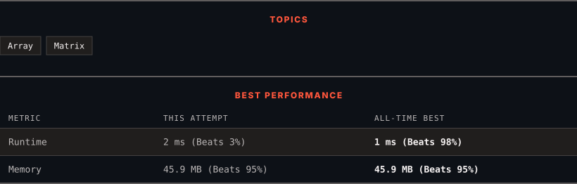

# 3142. Check if Grid Satisfies Conditions

      

---

<picture>
  <source media="(prefers-color-scheme: dark)" srcset="panel-dark.svg">
  <source media="(prefers-color-scheme: light)" srcset="panel-light.svg">
  
</picture>

> **New personal best** — Runtime improved on this submission.

### HOW IT WENT

| | |
|:--|:--|
| **Attempts** | 5 before accepted |
| **Time to solve** | 15 min |
| **Verdicts** | ❌ Wrong Answer → ❌ Wrong Answer → ✅ Accepted → ✅ Accepted → ✅ Accepted |

---

### NOTES

_No notes yet._

---

### SOLUTIONS (1)

| # | File | Language | Date |
|:-:|------|:--------:|:----:|
| 1 | [sol1.java](./sol1.java) | `Java` | 2026-10-23 ← **latest** |

---

### PROBLEM DESCRIPTION

You are given a 2D matrix `grid` of size `m x n`. You need to check if each cell `grid[i][j]` is:

	- Equal to the cell below it, i.e. `grid[i][j] == grid[i + 1][j]` (if it exists).

	- Different from the cell to its right, i.e. `grid[i][j] != grid[i][j + 1]` (if it exists).

Return `true` if **all** the cells satisfy these conditions, otherwise, return `false`.

 

**Example 1:**

**Input:** grid = [[1,0,2],[1,0,2]]

**Output:** true

**Explanation:**

****

All the cells in the grid satisfy the conditions.

**Example 2:**

**Input:** grid = [[1,1,1],[0,0,0]]

**Output:** false

**Explanation:**

****

All cells in the first row are equal.

**Example 3:**

**Input:** grid = [[1],[2],[3]]

**Output:** false

**Explanation:**

Cells in the first column have different values.

 

**Constraints:**

	- `1 <= n, m <= 10`

	- `0 <= grid[i][j] <= 9`

---

Auto-synced by <strong>LeetSync</strong> · Built by <a href="https://deveshsamant.in/">Devesh Samant</a>

