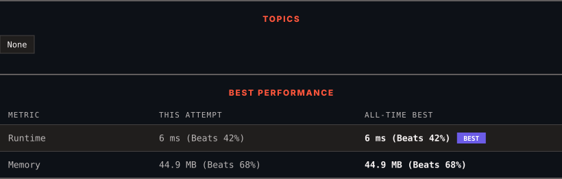

# 4097. Minimum Value of Merged Integers

      

---

<picture>
  <source media="(prefers-color-scheme: dark)" srcset="panel-dark.svg">
  <source media="(prefers-color-scheme: light)" srcset="panel-light.svg">
  
</picture>

> **New personal best** — Runtime improved on this submission.

### HOW IT WENT

| | |
|:--|:--|
| **Attempts** | first try |
| **Time to solve** | 7 min |
| **Verdicts** | ✅ Accepted |

---

### NOTES

_No notes yet._

---

### SOLUTIONS (1)

| # | File | Language | Date |
|:-:|------|:--------:|:----:|
| 1 | [sol1.java](./sol1.java) | `Java` | 2026-11-02 ← **latest** |

---

### PROBLEM DESCRIPTION

You are given an integer array `nums` of even length `n`.

You have to **merge** the elements of `nums` in pairs by merging `nums[0]` with `nums[1]`, `nums[2]` with `nums[3]`, and so on, until `nums[n - 2]` with `nums[n - 1]`.

Return the **minimum** value among all the resulting merged integers.

To **merge** two integers, concatenate all the decimal digits of the first integer followed by all the decimal digits of the second integer.

 

**Example 1:**

**Input:** nums = [23,55,42,21]

**Output:** 2355

**Explanation:**

	- Merging `nums[0] = 23` and `nums[1] = 55` gives 2355.

	- Merging `nums[2] = 42` and `nums[3] = 21` gives 4221.

	- The minimum value among the merged numbers is `min(2355, 4221) = 2355`.

**Example 2:**

**Input:** nums = [34,7,11,11]

**Output:** 347

**Explanation:**

	- Merging `nums[0] = 34` and `nums[1] = 7` gives 347.

	- Merging `nums[2] = 11` and `nums[3] = 11` gives 1111.

	- The minimum value among the merged numbers is `min(347, 1111) = 347`.

**Example 3:**

**Input:** nums = [9,20]

**Output:** 920

**Explanation:**

	- Merging `nums[0] = 9` and `nums[1] = 20` gives 920.

	- There is only one merged number, so the minimum value is 920.

 

**Constraints:**

	- `2 <= n == nums.length <= 100`

	- `n` is even

	- `1 <= nums[i] <= 1000`

---

Auto-synced by <strong>LeetSync</strong> · Built by <a href="https://deveshsamant.in/">Devesh Samant</a>

